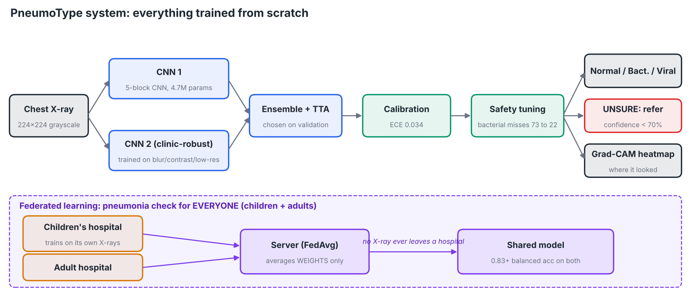
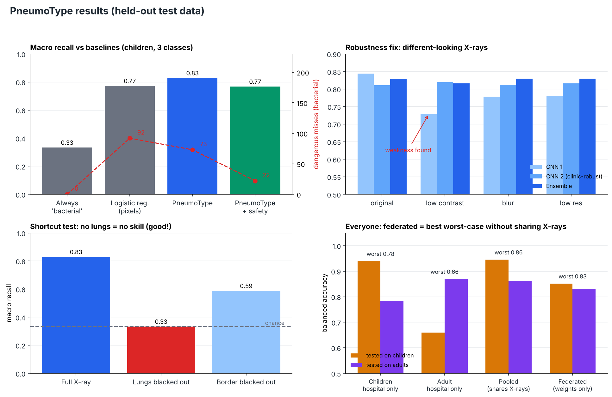
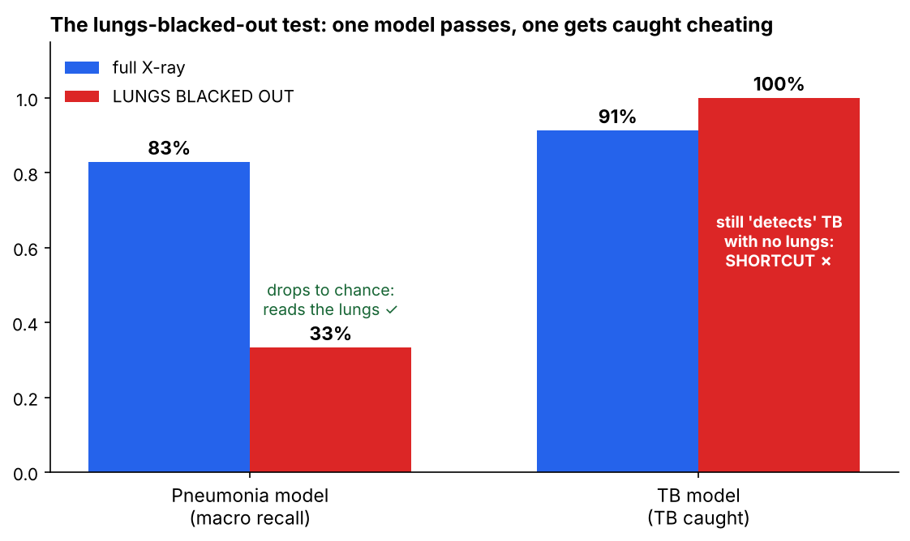

# PneumoType: what kind of pneumonia is this X-ray?

**Track:** Health
**Team:** [add team names]

> This project is a prototype and is not medical advice.

**In one sentence:** PneumoType catches **97% of pneumonia** on chest X-rays it has never seen, tells a doctor whether it looks **bacterial or viral**, says **"unsure, refer"** instead of guessing, and can be trained across hospitals with **federated learning**, so no hospital has to share a single patient X-ray.

Everything is our own convolutional neural network, **trained from scratch** (no pretrained models).

## Key findings
1. **97% of pneumonia caught** on 799 unseen children's X-rays (95% CI 96–99%), with only **7 false alarms** out of 222 healthy X-rays, beating a simple baseline.
2. **Safety tuning cut dangerous misses (bacterial cases called viral or normal) from 92 to 18**, and the tool says **"unsure, refer"** instead of guessing. When it's at least 90% confident, it's right **98%** of the time (97.7%).
3. **We found a weakness and fixed it:** our first CNN fell to 66% on low-quality X-rays, and a second "clinic-robust" CNN brought it back to 83%.
4. **Federated learning across a children's and an adult hospital** gave the best worst-case result of any setup that keeps X-rays private.
5. **A statistical guarantee, not just a confidence score:** with conformal prediction, the true diagnosis is inside PneumoType's answer **96.4%** of the time on unseen X-rays (target 95%). When it gives a single answer, it's right **95%** of the time; when it can't tell the type, it says "pneumonia, bacterial or viral" instead of guessing.
6. **We caught our own TB model cheating:** it "detects" TB even with the lungs blacked out. Our pneumonia models pass that test, so we kept TB out of the demo.

## The problem
Pneumonia is the biggest infectious killer of children under five worldwide. When a child arrives at a clinic with a cough and fever, the doctor has to decide fast whether it's bacterial pneumonia (needs antibiotics), viral pneumonia (usually doesn't) or no pneumonia at all, often without a radiologist. Guessing wrong either way causes harm: a missed bacterial infection, or unnecessary antibiotics that drive resistance.

**Our user:** a doctor at a children's clinic with no radiologist on hand, who wants a fast, honest second opinion on a chest X-ray.

## What we built
- **Input:** one chest X-ray.
- **Output:**
  1. Normal / bacterial pneumonia / viral pneumonia, with calibrated probabilities.
  2. A heatmap of where the model looked.
  3. **"UNSURE: refer to a doctor"** when it isn't confident.
  4. A pneumonia check for **anyone, children or adults**, from a model trained with federated learning.
- **Demo:** a Gradio web app (shown in the video), launched from the last section of the notebook.

## What we added
Our own idea. Beyond a basic pneumonia classifier, we added:
1. **Pneumonia type** (bacterial vs viral), because the type changes the treatment.
2. **Safety tuning** that makes the most dangerous mistake (calling a bacterial case viral or normal) rarer, chosen on validation data only.
3. **An "unsure, refer" mode** with **calibrated** confidence.
4. **A robustness fix:** we found our first CNN breaks on lower-quality X-rays, so we trained a second CNN on simulated "different clinic" images and ensembled the two.
5. **A shortcut test:** we blacked out the lungs to check the model isn't cheating off image borders.
6. **Children and adults with federated learning:** two simulated hospitals train one model and share only weights, never X-rays.
7. **95% confidence intervals**, bootstrapped by patient.
8. **Tuberculosis with four hospital-shortcut checks.** They caught our TB model cheating, so we left TB out of the demo (see below).

## How it works
**Data**
- **Children:** Kermany et al. 2018 pediatric chest X-rays from Guangzhou Women and Children's Medical Center, about 5,800 images of children aged 1–5 (normal / bacterial / viral). Split **by patient** 70/15/15, so no child appears in both training and test. The test set has 799 X-rays.
- **Adults:** COVID-19 Radiography Database. We used 6,000 X-rays: normal and lung-opacity X-rays from RSNA, and COVID-19 pneumonia X-rays.
- **Leakage check:** that database re-uses 1,341 "normal" X-rays from the children's dataset. We **removed** them using its source metadata.

**Models** (all trained from random weights)
- **The CNN:** 5 blocks of convolution → batch norm → ReLU → max-pool (32 to 512 filters), then global average pooling, dropout and a linear layer. About 4.7M parameters, 224×224 grayscale input, class-weighted loss, 25 epochs. We kept the epoch with the best validation macro recall.
- **CNN 2 ("clinic-robust"):** the same architecture, trained with random contrast, blur and low-resolution augmentation.
- **Final model:** the ensemble of CNN 1 and CNN 2, plus test-time augmentation. It was **chosen on validation**, not test. Temperature calibration was checked too (temperature 0.95; calibration error ECE fell from 0.044 to 0.037).
- **Federated model:** FedAvg across a "children's hospital" and an "adult hospital". Each trains locally for one epoch per round and a server averages the weights, for 8 rounds.

## Results (held-out test set, never used for training or model choice)

### Children: normal / bacterial / viral (799 test X-rays)
| Model | Accuracy | Macro recall | Bacterial recall | Viral recall | Pneumonia caught | False alarms (of 222 normal) | Dangerous misses* |
|---|---|---|---|---|---|---|---|
| Baseline: always "bacterial" | 0.468 | 0.333 | 1.000 | 0.000 | 1.000 | 222 | 0 |
| Baseline: logistic regression on 32×32 pixels | 0.771 | 0.772 | 0.754 | 0.675 | 0.953 | 25 | 92 |
| **Final model (ensemble + TTA)** | **0.844** | **0.842** | 0.834 | **0.724** | 0.972 | **7** | 62 |
| **Final + safety tuning** | 0.816 | 0.775 | **0.952** | 0.453 | **0.993** | 18 | **18** |

*Dangerous misses = bacterial pneumonia called viral or normal, so the child could miss antibiotics. *Macro recall* averages recall across classes, so a model can't score well by ignoring one.

- **95% confidence intervals** (bootstrapped by patient): accuracy **0.844 [0.816–0.870]**, macro recall **0.842 [0.814–0.871]**, pneumonia caught **0.972 [0.958–0.985]**.
- **Safety tuning** cut dangerous misses from 62 to 18 and raised pneumonia caught to 99.3%. The cost: more viral cases get called bacterial (viral recall falls from 72% to 45%). We think that's the right trade for a clinic, because over-treating a viral case is less harmful than missing a bacterial one.
- **Unsure mode:** at 70% confidence the tool decides on 74% of X-rays with **91.0% accuracy** and refers the rest. At 90% confidence it decides on 37% with **97.7% accuracy**.

Final confusion matrix (rows = true, columns = predicted):

| | normal | bacterial | viral |
|---|---|---|---|
| **normal** | 215 | 1 | 6 |
| **bacterial** | 8 | 312 | 54 |
| **viral** | 8 | 48 | 147 |

### Robustness: we found a weakness and fixed it
Macro recall on test X-rays made to look like they came from a different machine:

| Test images | CNN 1 (original) | CNN 2 (clinic-robust) | Ensemble |
|---|---|---|---|
| Original | 0.825 | 0.837 | **0.839** |
| Low contrast | **0.662** | **0.828** | 0.808 |
| Blur | 0.724 | 0.834 | 0.834 |
| Low resolution | 0.726 | 0.833 | 0.833 |

CNN 1 dropped to 0.662 on low-contrast X-rays. CNN 2 and the ensemble stay at about 0.81–0.84 on every kind of image.

### Shortcut test: is it really looking at the lungs?
| Input | Macro recall |
|---|---|
| Full X-ray | 0.839 |
| **Lungs blacked out** (only the border visible) | **0.336 (≈ chance, 0.333)** |
| Border blacked out (only the lungs visible) | 0.469 |

With the lungs hidden, the model is no better than guessing. It is **not** using hospital markers or image borders as a shortcut: its skill comes from the lungs.

### Everyone: children + adults with federated learning (pneumonia vs normal)
Balanced accuracy on each population's test set (AUC in brackets):

| Model | X-rays shared? | Children | Adults | Worst case |
|---|---|---|---|---|
| Children's hospital only | no | 0.917 (0.976) | 0.749 (0.813) | 0.749 |
| Adult hospital only | no | 0.660 (0.917) | 0.870 (0.958) | 0.660 |
| Pooled (all X-rays in one place) | **yes** | 0.948 (0.987) | 0.867 (0.942) | 0.867 |
| **Federated (FedAvg)** | **no, weights only** | 0.884 (0.954) | 0.831 (0.914) | **0.831** |

- **Federated learning has the best worst-case of any private option.** A model trained at one hospital does badly at the other: the adult-only model caught only 32% of pneumonia in children.
- **Pooling all the data does best,** but it needs hospitals to hand over patient X-rays.
- **Honest limitation:** the federated model is more cautious on children than pooling. It caught 82% of pneumonia (pooled: 95%), with 95% of normal X-rays correctly cleared. Its AUC of 0.954 shows the ranking is good, so the decision threshold is the issue.

### Conformal prediction: a guaranteed safety net
A confidence score can be wrong about itself. **Conformal prediction** fixes that with a math guarantee: using the 849 validation X-rays, we pick a cut-off so that the answer is a *set* of possible diagnoses that contains the true one at least 95% of the time on new X-rays (split conformal, LAC score).

| Target | Actual coverage (799 test X-rays) | Avg. labels in answer | Single-label answers | Accuracy of single-label answers | Coverage: normal / bacterial / viral |
|---|---|---|---|---|---|
| 80% | 82.6% | 0.97 | 97% | 85.2% | 95.5% / 81.8% / 70.0% |
| 90% | 93.2% | 1.26 | 74% | 91.7% | 98.2% / 92.2% / 89.7% |
| **95%** | **96.4%** | **1.44** | **58%** | **95.0%** | **99.5% / 94.9% / 95.6%** |

At 95%, the answers on the test set were: *normal* 206, *bacterial* 155, *viral* 101, ***bacterial or viral*** 292, *normal or viral* 22, *normal or bacterial* 8 and *all three* 15. The most common uncertain answer, "pneumonia, but the type is unclear", is clinically useful in its own right: it says to treat this as pneumonia and get more tests to decide on antibiotics. This matches the biology, since bacterial and viral pneumonia often look alike on an X-ray.

### Per-hospital thresholds for the federated model
Each hospital keeps the shared federated model but picks its own decision threshold on its own validation X-rays. No X-rays are shared.

| Hospital | Threshold | Balanced acc | Pneumonia caught | Normal cleared |
|---|---|---|---|---|
| Children | shared (0.5) | 0.884 | 81.8% | 95.0% |
| Children | **own (0.42)** | **0.891** | **86.8%** | 91.4% |
| Adults | shared (0.5) | **0.831** | 88.7% | 77.6% |
| Adults | own (0.73) | 0.824 | 77.8% | 87.1% |

**Honest result:** local thresholds helped the children's hospital (5 points more pneumonia caught) but slightly hurt the adult hospital, because the threshold chosen on adult validation X-rays didn't carry over to test. That's a useful lesson: per-hospital tuning needs more validation data than we had. For a clinic, we'd also choose thresholds for a target sensitivity rather than balanced accuracy.

### Tuberculosis: we caught our own model cheating
We added the **Tuberculosis (TB) Chest X-ray Database** (adults; 700 TB + 1,400 normal sampled) as a third hospital, after removing **duplicate images across datasets** with an image fingerprint. Then we trained a normal / pneumonia / TB model.

| Model (normal / pneumonia / TB) | Balanced acc (all 3 hospitals) | TB caught | Normal X-rays called TB (children / adults / TB hospital) |
|---|---|---|---|
| Pooled (shares X-rays) | 0.854 | 91.3% | 0% / 6.7% / 10.3% |
| Federated, 3 hospitals | 0.536 | **0%** | n/a |

On paper, TB detection looks great: 91% caught. **Our four shortcut checks say not to trust it:**
1. **Hospital detector:** a CNN trained only to guess the hospital gets **92.4%** right (chance is 33%), so the hospitals' X-rays look very different.
2. **Same-hospital test:** inside the TB hospital it still catches 91.3% of TB, with 89.7% of normals cleared.
3. **Normals called TB:** this happens more often at the TB hospital (10.3%) than for adults (6.7%) or children (0%), a hint of a hospital effect.
4. **Lungs blacked out:** the model **still "detects" TB 100% of the time with no lungs visible.** That's the smoking gun. Its TB decision is driven by something outside the lungs, such as the image source, borders or exposure, not by the disease.

**Conclusion:** our pneumonia models pass the lungs-blacked-out test (they drop to chance), but the TB model fails it. This is the same trap as the well-known COVID-19 X-ray AI shortcut problem (DeGrave et al., *Nature Machine Intelligence*, 2021). We therefore **do not offer TB detection** in the demo. With only one hospital supplying TB cases, federated learning also failed: the TB hospital's signal was averaged away and the federated model caught 0% of TB. A trustworthy TB model needs TB *and* normal X-rays from many hospitals.

## Where it fails
- **Bacterial vs viral mix-ups** cause most errors (102 of 125). That's expected, because even radiologists can't reliably tell the type from an X-ray alone.
- **The most confident mistakes are pneumonia cases called normal.** These look like mild or early cases where the signs are faint at 224×224.
- **Federated model on children:** it misses more pneumonia than pooling. A local threshold narrows the gap (82% → 87% caught), but the same trick slightly hurt the adult hospital.
- **Data limits:**
  - The children's data comes from one hospital, with no age or sex labels, so we couldn't check fairness across those groups.
  - Labels are doctors' readings, not lab-confirmed causes.
  - Adult X-rays come from different sources than the children's, so some differences between them may come from equipment, not age.

## What we'd do next
1. Add more hospitals to the federation, and set each hospital's threshold for a target sensitivity using more validation data.
2. Fix the TB shortcut: gather TB and normal X-rays from the *same* hospitals, and train with lung segmentation so the model can only see the lungs.
3. Test with real clinicians at a clinic, on X-rays from a new hospital.

## Sources
- **Children's dataset:** Kermany, Zhang & Goldbaum (2018), *Labeled Optical Coherence Tomography (OCT) and Chest X-Ray Images for Classification*, Mendeley Data. Kaggle copy: "Chest X-Ray Images (Pneumonia)" by Paul Mooney (CC BY 4.0).
- **TB dataset:** Tuberculosis (TB) Chest X-ray Database, Rahman et al. 2020, Kaggle (tawsifurrahman/tuberculosis-tb-chest-xray-dataset).
- **Adult dataset:** COVID-19 Radiography Database, Chowdhury et al. 2020 and Rahman et al. 2021, Kaggle (tawsifurrahman/covid19-radiography-database). It includes RSNA Pneumonia Detection Challenge images.
- **Methods:** split conformal prediction (Angelopoulos & Bates, 2021), shortcut learning in COVID-19 X-ray AI (DeGrave et al., 2021), FedAvg (McMahan et al., 2017), Grad-CAM (Selvaraju et al., 2017), temperature scaling (Guo et al., 2017).
- **Libraries:** PyTorch, torchvision, scikit-learn, pandas, matplotlib, Gradio.
- **No pretrained models.**
- **AI tools:** Claude (Anthropic) helped plan the project and draft code and this write-up. [Add any others.]

## How to run
- **Full project:** open `pneumotype.ipynb` on Kaggle and add the three datasets above as inputs. Turn on GPU T4 and Internet, then Run All. It takes about 90 minutes.
- **Upgrades (conformal + per-hospital thresholds):** open `pneumotype_upgrades.ipynb` with the PneumoType notebook's output and the two pneumonia datasets as inputs. It reuses the trained weights and takes about 3 minutes.
- **Demo only:** open `pneumotype_demo.ipynb` and add the PneumoType notebook's output (the trained weights) as an input. It launches the Gradio app in about 2 minutes.
